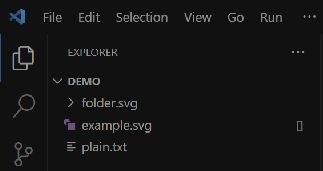
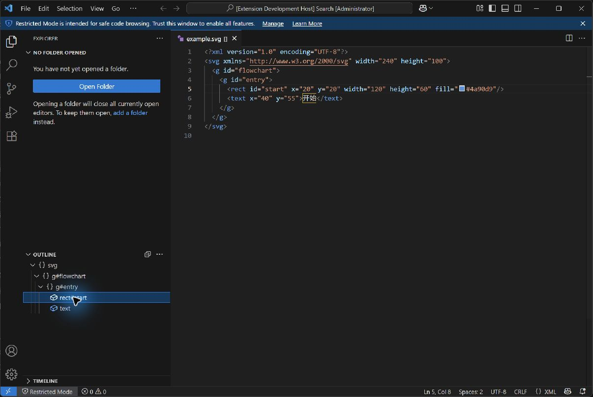
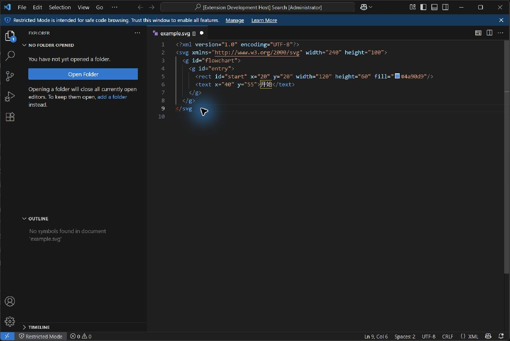

# SVG 编辑器 CLI 与 VS Code 扩展

**作者**：23300220005 许颖忱

[GitHub 仓库](https://github.com/HydrogenC/SoftwareDesignPJ1)

Phase 1 实现 SVG 编辑器 CLI，支持分组、树形查看、文件读写和撤销重做。Phase 2 将 CLI 改为插件式架构，并增加 VS Code 扩展。

## Phase 1 架构方案

### 模块划分

| 目录 | 职责 |
| --- | --- |
| `src/svg/` | `Shape` 定义图形接口，叶子类实现各自的几何行为，`Container`、`Group` 和 `Document` 表达复合结构。`EditorError` 表示业务错误。 |
| `src/registry/` | `ShapeFactory` 按类型构造图形。`create` 接收 CLI 参数，`fromSvg` 接收解析后的 SVG 属性。 |
| `src/io/` | `SvgReader` 解析 SVG、补全缺失的 ID 并发出警告。`SvgWriter` 转义并保存 SVG。 |
| `src/commands/` | 各 `Command` 子类定义命令及其逆操作。`CommandContext` 保存当前文档和路径，并提供工厂、读写器和树渲染函数。 |
| `src/cli/` | `LineParser` 解析输入，`CommandRouter` 分发命令，`CommandHistory` 管理撤销、重做和 IO 锁，`TreeFormatter` 排版，`Repl` 读写终端。 |
| `src/index.ts` | 创建各层实例，注入共享的图形工厂等依赖。 |


图由 `doc/architecture.puml` 生成。

### 设计模式

**Command**。编辑、显示和文档命令都继承 `Command`。各命令实现 `execute()`，可撤销的命令还实现 `undo()`，`redo()` 默认调用 `execute()`。`CommandHistory` 根据 `kind`、`resetsHistory` 和 `locksHistory` 管理历史。

**Composite**。`Group` 和 `Document` 都是 `Container`，由容器递归处理子节点。编辑命令统一使用 `Shape`，通过 `asContainer()` 判断图形能否接收子节点，通过 `children` 遍历。

**Factory**。CLI 创建和 SVG 读入都通过 `ShapeFactory` 选择图形类，各图形自行实现几何运算和 SVG 属性输出。按名称分派集中在 `CommandRouter` 的命令表和 `ShapeFactory` 的类型表。

**Template Method 与依赖注入**。`Command` 提供参数检查、数字解析和回显格式，子类实现具体命令。`index.ts` 将工厂注入 `SvgReader`，将路由器注入 `Repl`，并为 `CommandContext` 提供读写、构造和树渲染服务。

### 依赖方向

- `svg/` 只依赖自身。
- `registry/` → `svg/`。
- `io/` → `svg/`、`registry/`。只有 `SvgReader` 使用工厂。
- `commands/` → `svg/`、`registry/`、`io/`。`CommandContext` 只引用读写服务的类型。
- `cli/` → `commands/`、`svg/`。
- `index.ts` 依赖上面各层。

依赖只沿图中方向，禁止反向引用和循环。领域模型独立于终端和文件读写，解析器可以在 `io/` 内替换。命令表和类型表留到插件阶段改为注册机制。

### 变化点假设

1. 新增图形时，实现一个 `Shape` 子类并向工厂表加一项。Phase 1 没有插件加载要求，先用静态类型表。
2. 新增命令时，实现 `Command` 子类并增加路由项。较少的命令和别名可以集中维护。
3. SVG 格式或容错规则变动时，修改 `io/` 中的解析和写出代码。
4. 批量操作若难以逆转，可由对应命令用 Memento 保存必要状态，避免每步复制整份文档。
5. 属性和展示规则目前由图形类维护。属性种类或输出格式增多后，再考虑属性 schema 或 Visitor。
6. 题面以 ID 寻址。结构路径会涉及多条命令，本阶段没有预留接口。

## 过程记录

- 开工前，我先审核领域模型和命令层的边界，包括 `Shape` 的职责、容器接口，以及命令和历史各自负责什么。确认这些分工后才开始实现。`tree` 和 `show` 的展示细节交由 AI 拟定。
- AI 提出将编排放在 `app/`，终端交互放在 `repl/`。我决定合并到 `cli/`，因为 `app/` 当时只需转发调用，并把对象装配集中在 `index.ts`。
- 实现从图形和容器开始，再做命令与 CLI，每层审核通过后继续。Git 历史分为脚手架、图形模型、命令、CLI 装配四次提交。
- 编译检查发现 `exactOptionalPropertyTypes` 下不能给可选绘制属性赋 `undefined`，于是改为 `string | undefined`。同一阶段补上了 `SvgReader` 缺失的 `ShapeFactory` 参数，并修正了 `GroupCommand` 和 `UngroupCommand` 的导入与类型引用。
- 回放第 6 节时，`addto node1` 报找不到节点。检查会话发现，前面的 `ungroup` 和 `redo` 已经移除了 `node1`。

## 一致性自查

- Phase 1 的目录与定稿一致。`app/` 和 `repl/` 的合并记录见上一节。
- 抽查导入关系，`svg/` 只引用自身，`node:fs` 只在 `io/` 使用，`commands/` 不引用 `cli/`。未发现循环依赖。名称分派集中在 `CommandRouter` 和 `ShapeFactory`。
- `tree` 和 `show` 统一显示已设置的绘制属性。题面有一处手写样例省略了这些属性。

## 质量保证手段

- `npm run typecheck` 和 `npm run build` 均通过，并用 `node dist/index.js` 启动了编译产物。TypeScript 启用了 `strict`、`noUncheckedIndexedAccess` 和 `exactOptionalPropertyTypes`。
- `npm test` 回放 `doc/transcript/` 中的会话，以 `phase1-final` 的实测结果为基线。题面第 6 节的会话用于核对树缩进、命令回显、撤销重做和保存后的历史锁。
- 边界检查包括跨父容器分组、解组和换序后的撤销、修改画布尺寸后的历史锁、读入时补全 ID 和跳过未知标签、实体转义及保存后重新读入。
- 在浏览器检查了 `examples/minimal.svg` 和回放生成的 `demo.svg`、`flowchart.svg`。

## Phase 2 · VS Code SVG 扩展

### 构建和启动

在仓库根目录运行以下命令。需要 Node.js、npm，以及 PATH 中的 `code` 命令。

```sh
npm --prefix vscode-svg ci
npm --prefix vscode-svg run build
code "--extensionDevelopmentPath=$PWD/vscode-svg" "$PWD/vscode-svg/demo"
```

在 Extension Development Host 中打开 `vscode-svg/demo/example.svg`，展开 Explorer 下方的 Outline。扩展默认用文本编辑器打开 SVG。如果用户或工作区设置了 Image Preview，可在 `workbench.editorAssociations` 中把 `"*.svg"` 设为 `"default"`。

### VS Code 验收

使用 VS Code 1.103.2。实现前用 `Shape.ts` 观察原生 Outline，点击 `Point` 下的 `x` 会跳到字段声明。未启用扩展时，打开 SVG 源码的大纲为空。

| 操作 | 实际结果 |
| --- | --- |
| 查看 Explorer | `example.svg` 显示 `[]`，文件名和内容不变。`folder.svg` 目录与 `plain.txt` 无标记。 |
| 展开 Outline 并点击 `rect#start` | 大纲显示 `svg`、`g#flowchart`、`g#entry` 及其下的 `rect#start` 和 `text`。点击后光标停在第 5 行第 8 列的标签名。 |
| 将 `id="start"` 改为 `id="begin"` | 保存前，大纲已显示 `rect#begin`。 |
| 删除末尾 `</svg>` 的 `>`，再撤销 | XML 不完整时大纲清空，撤销后恢复。 |







`npm --prefix vscode-svg test` 检查嵌套、缺少 ID 的元素、UTF-16 源码范围和不完整 XML。宿主测试还检查文件徽标、默认编辑器和未保存时的大纲更新。以下 PowerShell 命令用独立配置启动宿主测试。

```powershell
$svgTestProfile = Join-Path ([IO.Path]::GetTempPath()) "svg-outline-test-$([guid]::NewGuid())"
code --user-data-dir "$svgTestProfile" --extensions-dir "$svgTestProfile/extensions" --verbose "--extensionDevelopmentPath=$PWD/vscode-svg" "--extensionTestsPath=$PWD/vscode-svg/test/extension-host.cjs"
```

通过时日志含 `SVG Extension Host assertions passed`，宿主退出码为 0。

### 宿主、接口与对象职责

VS Code 调用 `activate`，扩展注册 `FileDecorationProvider` 和 `DocumentSymbolProvider`。注册返回的 `Disposable` 放入 `context.subscriptions`，随扩展一起释放。宿主渲染文件项时请求徽标，打开或编辑 SVG 时请求符号，并负责大纲的层级、展开和跳转。

经典 Decorator 包裹原对象，且与它实现相同的接口。这里的文件项由 VS Code 管理，扩展通过独立的 provider 接口返回 `FileDecoration`，由宿主在渲染时加上徽标。

`SvgFileDecorationProvider` 调用 `workspace.fs.stat`，把文件类型转换为宿主需要的装饰信息。`SvgDocumentSymbolProvider` 使用 `SvgOutlineParser`，将解析出的层级和源码偏移转换为 `DocumentSymbol` 的父子关系、元素范围和标签名范围。两个 provider 都承担了 Adapter 的职责。

### Phase 1 复用评估

Phase 1 的 `SvgReader` 能解析 XML 层级，要供大纲复用还需拆出解析器并保留源码偏移。扩展采用 Saxes，直接从源码取元素和位置。CLI 读入会跳过不支持的标签，并为缺少 ID 的元素分配 ID。大纲保留源码里的元素和 ID，缺少 ID 时只显示标签名，因此不复用 `Document` 和 `Shape`。

两部分都按子节点顺序递归遍历。CLI 的 `TreeFormatter` 输出排好版的文本，VS Code 大纲需要带源码范围的 `DocumentSymbol` 树，因此分别实现。

### 大纲跳转的修正

AI 的初版设置了 `DocumentSymbol.selectionRange`，宿主测试通过，但手动点击大纲时仍进入图片预览。随后在扩展清单里为 SVG 设置默认文本编辑器，并在宿主测试中检查打开的编辑器类型。再次点击 `rect#start` 时，光标跳到了源码标签名。

## Phase 2 · CLI 插件框架

`doc/phase2-report.md` 记录架构变化和验收结果。重构前后的依赖图分别由 `doc/architecture.puml` 和 `doc/architecture-phase2.puml` 生成。`doc/cli-plugin-adr.md` 记录设计决策，`doc/metrics/final.md` 列出重构指标。

### 扩展点清单

启动时加载 `builtin` 插件，提供 Phase 1 命令和六种基础图形。表中提到的测试实现位于 `test/plugin-framework.test.mjs`。

| 接口 | 内核调用位置 | 实现 | 禁用可选插件后的行为 | 契约错误 |
| --- | --- | --- | --- | --- |
| `ShapeProvider` | `ShapeFactory.ts` 的 `create` 构造图形。`SvgReader.ts` 的 `#readChildren` 调用工厂的 `forSvg` 和 `fromSvg` | 六个 `BuiltinShapeProvider` 实例和 `BoxProvider`。测试用 `CompositeProvider` | 六种基础图形可用。创建未注册图形时报 `error: unknown shape type`。读入时将标记为 `box` 的 `<g>` 当作普通组，跳过未知标签 | 图形须与请求的 ID、类型和 SVG 标签匹配，且尚未挂入父容器。读入时须返回未挂子节点的图形。违反时报 `error: shape provider <name> failed: ...`。`BoxProvider` 还会检查必要部件及其类型 |
| `Command`、`CommandDefinition` | `CommandRouter.ts` 的 `run` 从注册表构造命令，`CommandHistory.execute` 执行。`EditorSession.helpLines` 获取帮助文本 | Phase 1 命令及 `stats`、`dir`。测试用 `SampleDefinition` 和 `SampleCommand` | Phase 1 命令及历史行为不变。未注册命令执行时报 `error: unknown command: <name>`，也不会出现在帮助中 | 须返回类别有效的 `Command` 实例，`help` 须返回字符串。违反时报 `error: command <name> failed: ...` |
| `TreeDecorator` | `TreeFormatter.ts` 的 `#suffix` 追加标签。`EditorSession.ts` 的 `#publish` 提供新建、读入和保存事件 | `BoxTypeLabel`、`ModifiedStar`。测试用两个 `TreeLabel` 实例 | 树输出与 Phase 1 逐字节一致 | 返回多行、非字符串或抛出异常时报 `error: tree decorator <name> failed: ...` |
| `AttributeHandler` | `EditorSession.setAttribute` 调用 `AttributeEdit.ts` 的 `apply`，选择处理器并记录修改 | `BoxAttributes` 处理 `fill` 和 `label`。测试用 `PaintHandler` | 无处理器匹配时使用图形的属性白名单，未知属性报 `error: unknown attribute: <attr>` | 多个处理器匹配时报 `error: conflicting attribute handlers ...`。异常时回滚已完成的更改，普通异常报 `error: attribute handler <name> failed: ...` |

`PluginHost.ts` 的 `load` 负责验证注册。同类名称重复报 `error: duplicate registration: <category>/<name>`。声明与实际注册不符报 `error: plugin manifest mismatch: ...`。激活异常报 `error: plugin failed to activate: ...`。这三种情况都会撤销该插件的暂存注册。

### 两种装配方式

在仓库根目录运行 `npm ci` 和 `npm run build`，然后选择启动方式。直接启动时使用代码装配，`--config` 读取指定配置，`--no-plugins` 只加载内置插件。

```sh
node dist/index.js
node dist/index.js --no-plugins
node dist/index.js --config plugins.config.json
```

代码装配在 `src/index.ts` 的 `codePlugins` 中列出导入函数和可选的 `options`。CLI 按数组顺序读取默认导出的插件实例和 `manifest`。外部插件通过 `svg-editor/api` 导入公开接口，仓内插件可用相对路径导入编译后的 API。

配置装配按 `plugins` 的顺序加载，`enabled: false` 跳过该项。`module` 可填已安装的包名、入口文件或包目录。相对路径以配置文件所在目录为基准，包名按 ESM 规则解析，包目录用 `package.json` 的 `main` 找入口。模块默认导出带 `activate` 的实例，宿主把 `options` 原值传给 `activate` 的第二个参数。

```json
{
  "plugins": [
    { "module": "@example/plugin", "options": { "prefix": "demo" } },
    { "module": "./dist/plugins/other", "enabled": false }
  ]
}
```

插件在包清单的 `contributes` 中声明 `shapes`、`commands`、`decorators` 和 `attributes` 的名称列表，各项缺省为空。仓库的 `plugins.config.json` 与代码装配按相同顺序启用 `stats`、`dir`、`box` 和 `modified-star`。

加载前会检查整份配置。JSON 或结构有误时报 `error: invalid plugin config`，CLI 仍以基础功能启动。单个模块找不到或缺少默认导出时，会报错并继续处理后续条目。

`npm run cli` 会先构建，再启动编译入口，使宿主和插件引用同一份 `Command` 基类。从其他工作目录启动时，可将入口的绝对路径传给 `node`。

### 命令插件

- `stats` 从画布的子节点开始深度优先遍历，按叶子类型首次出现的顺序输出计数。容器单独计数，内部叶子仍计入各自的类型。先用 `init` 或 `read` 打开文档。
- `dir` 列出进程当前目录的直接子项，包括隐藏项。`dir` 可在打开文档前执行。目录显示为 `[DIR]` 并排在前面，其余项显示为 `[FILE]`。两组均按名称的 UTF-16 码元升序排列，区分大小写。命令不跟随符号链接。
- 两条命令都无参数。目录访问失败时报 `error: cannot read directory: <path>`，无法取得工作目录时路径显示为 `.`。

`DirCommand` 通过构造器接收 `DirectoryAccess`，用 `currentPath()` 和 `list(path)` 查询目录。`DirectoryAccess.ts` 中的 `NodeDirectoryAccess` 是对象适配器，调用 `process.cwd()` 和 `fs.readdirSync()`，把 `Dirent` 转换成只含名称和目录标记的 `DirectoryEntry`。两种装配都由 `DirPlugin` 注入同一默认适配器，独立测试可传入替身。

构建后用 `node --test test/stats.test.mjs test/dir.test.mjs` 运行独立测试。`test/command-plugins.test.mjs` 在同一个临时目录回放 `doc/transcript/command-plugins.txt`，逐字节比较两种装配的输出，并检查选择性启用、进程工作目录以及 `dir` 成功或失败后文档和历史的状态。

### 复合图形 `box`

`BoxPlugin` 注册图形、属性处理器和树标签。`create box <id> <x> <y> <w> <h> "<标题>" [in <containerId>]` 创建矩形和文本。矩形用示例的蓝色 `#4a90d9`。文本横坐标为 `x + 20`，基线为 `y + h / 2 + 5`。`set <id> fill <颜色>` 修改矩形填色，`set <id> label "<标题>"` 修改文本，两条命令均可撤销和重做。树上的 `(box)` 由装饰器追加。

以 `8844109` 为基线，两种装配都新增 `src/plugins/box/`。代码装配改 `src/index.ts`，配置装配改 `plugins.config.json`。`doc/phase2-report.md` 中的「装配差异复核」记录了复现步骤。回放版本 B 时，两者的标准输出和 SVG 均与预期逐字节一致。

构建后运行 `node --test test/box-plugin.test.mjs test/box-cli.test.mjs`。CLI 测试使用 `doc/transcript/flowchart-box.txt` 回放。读入和结构约束记录在 ADR 第 2 节。

### 未保存标记 `modified-star`

ADR 第 4 节记录了基准和传播规则。`tree` 根据最近一次成功保存或读入的内容标记有变化的节点及其祖先。撤销到基准后星号消失。`init` 后的新画布立即标星，基准中没有对应 ID 的新节点也立即标星。标签按注册顺序显示，如 `g#n1 (box) *`。单独禁用 `modified-star` 后，`(box)` 仍显示。

构建后用 `node --test test/modified-star.test.mjs` 检查标签状态。`test/box-cli.test.mjs` 还会比较两种装配的双标签输出。

## Phase 2 协作与审阅

开工前，我让 AI 对照题面和现有代码拟定里程碑。我把第一次人工审阅安排在第一步完成后，后续由我决定何时进入下一步。AI 负责提出方案、实现和运行测试。

架构审阅时，我主要看内核、宿主和插件的职责边界。内核只依赖扩展接口，宿主负责加载和注册。接入 `box` 时，我看的是插件目录之外是否只改了装配处，以及代码和配置能否通过同一套注册流程加载同一个插件。兼容性以 `phase1-final` 的实测结果为准。禁用新增插件后，回放的标准输出和保存的 SVG 都要逐字节一致。

我要求在实际 VS Code 界面验收文件标记和大纲，检查从点击节点到跳转源码的完整操作。

收尾时，我对照提交清单，要求核查指标报告是否必交，以及文档和验证材料是否已经提交。审阅演示截图时，我指出旧图分辨率偏低，画面里还留着操作指针，随后手动补拍。文档目录也由我决定统一到 `doc/`。

### AI 建议检查记录

对照 Phase 1 的 `help`，保留了命令的注册顺序和分段空行。属性测试增加了撤销创建后再重做的场景，确认重做属性设置时按 ID 找到新创建的图形。命令回放也以 `CreateCommand.undo()` 的实际输出 `rect#r2 removed` 为准。

检查装配时把可选插件的静态导入改为按需导入，使禁用的条目无需加载模块。`npm run cli` 改用编译入口，避免宿主和插件加载两份 `Command` 基类。
