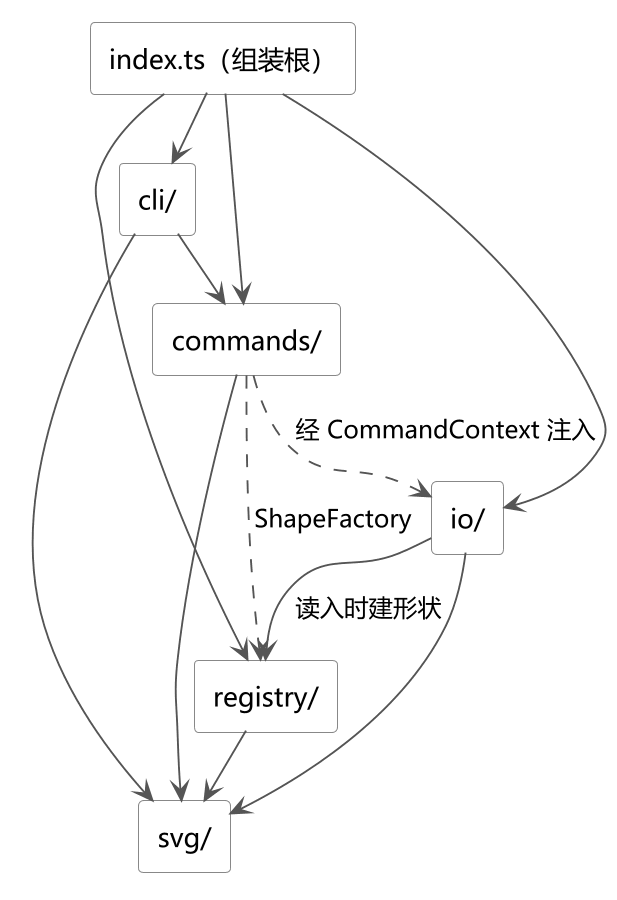

# SVG 编辑器 CLI（Lab1 Phase 1）

**作者**：23300220005 许颖忱

**云端仓库地址**：https://github.com/HydrogenC/SoftwareDesignPJ1

在 REPL 中创建和编辑 SVG 图形，支持分组、树形查看、SVG 读写以及 undo/redo。

## 架构方案

### 模块划分

| 目录 | 职责 |
| --- | --- |
| `src/svg/` | 领域模型。`Shape` 定义 id、变换、属性、渲染和 SVG 序列化接口；`Container` / `Group` / `Document` 实现复合结构；叶子类只处理自己的几何。`EditorError` 是统一业务异常。 |
| `src/registry/` | `ShapeFactory` 负责“类型名 → 图形类”。CLI 创建和 SVG 读入共用它，但参数来源不同，因此分为 `create` 与 `fromSvg` 两条入口。 |
| `src/io/` | `SvgReader` / `SvgWriter`。容错解析、缺 id 补全与警告、属性转换、转义和落盘都在这里；`node:fs` 只出现在这一层。 |
| `src/commands/` | 一个命令一个 `Command` 子类，自带 `execute` 和逆操作。`CommandContext` 持有当前文档、路径及注入的 factory / reader / writer / tree 渲染函数。 |
| `src/cli/` | 交互外壳：`LineParser` 拆行，`CommandRouter` 按命令名构造对象，`CommandHistory` 管 undo/redo 栈和 IO 锁，`TreeFormatter` 排版，`Repl` 读写终端。 |
| `src/index.ts` | 唯一的组装点，把共享 factory 和各层对象接起来。 |



图源：[architecture.puml](architecture.puml)

### 设计模式

**Command（规范要求）**。所有编辑、显示和文档命令都继承 `Command`，由子类实现 `execute()` 和 `undo()`，`redo()` 默认重新执行。基类用 `kind`、`resetsHistory`、`locksHistory` 描述命令类别，`CommandHistory` 只根据这些元信息压栈、清栈和上锁。undo 的语义跟着命令走，历史层不需要知道 `move` 和 `group` 的差别。

**Composite**。`Shape` 是统一接口，`Container` 递归处理子节点，`Group` 和 `Document` 都是容器。`move` / `scale` / `set` / `delete` 对叶子和容器一视同仁；能否收子看 `asContainer()`，遍历看 `children`，没有 `instanceof` 或按 tag 的分支。

**Factory 与两处按名分派**。`ShapeFactory` 把类型名映射到类，CLI 和 SVG 读入都走它。规范允许的两处按名分派就是 `CommandRouter` 的命令表和 `ShapeFactory` 的类型表，其余地方靠多态，例如每种图形自己拼几何属性和 SVG 属性。

**Template Method 与依赖注入**。`Command` 基类负责参数检查、数字解析和回显格式，子类只写业务；`SvgReader` 接收 `ShapeFactory`，`CommandContext` 接收 reader/writer/factory/renderTree，`Repl` 接收 router，对象统一在 `index.ts` 组装。

### 依赖方向

允许的依赖：

- `svg/`：只依赖自身。
- `registry/` → `svg/`。
- `io/` → `svg/`、`registry/`（只有 reader 需要工厂建形状）。
- `commands/` → `svg/`、`registry/`、`io/`（io 仅在 `CommandContext` 里作为注入的服务类型出现）。
- `cli/` → `commands/`、`svg/`。
- `index.ts` → 以上全部。

禁止反向依赖和循环：`svg/` 不能依赖 `registry/`、`io/`、`commands/`、`cli/`；`registry/` 和 `io/` 不能依赖 `commands/`、`cli/`；`commands/` 不能依赖 `cli/`。这样领域模型不受 IO 和交互方式影响，换解析器时不用动模型和命令。

`CommandRouter` 的命令表和 `ShapeFactory` 的类型表已标注为待重构：前者后续可改为注册表，后者在插件阶段改为外部注册 `ShapeProvider`。

### 变化点假设

1. **新增图形类型（包括后续的 `box` 插件）**：加一个 `Shape` 子类和一条工厂表项，命令层不用改。工厂表目前硬编码，没有提前做插件注册，因为本阶段没有插件生命周期和加载顺序的要求。
2. **新增命令或别名**：加一个 `Command` 子类和一条路由表项。命令数量还少，集中表比元数据驱动更直观；等别名、权限或参数差异多起来再抽注册表。
3. **SVG 格式或解析容忍度变化**：只改 `io/`。模型和命令只认 `Document` / `Shape`，不碰 XML。
4. **撤销模型变化**：目前是“每个命令自带逆操作”。如果以后出现难以逆运算的批量操作，会在该命令内部用 Memento 保存必要状态，而不是把历史层改成全量快照；全量快照更占内存，也会让命令语义变模糊。
5. **属性集合或展示格式扩展**：`set` 白名单和展示逻辑分散在各图形类里。属性少时这样改动局部、也符合多态；如果属性或输出格式明显增多，再考虑属性 schema 或 visitor，现在不提前抽象。
6. **寻址方式**：id 是规范确定的契约，没有为结构路径寻址留接口。真要做会波及所有命令，现阶段不值得预埋。

## 过程记录

- 先出架构、我审核，再分层实现，没有让 AI 一口气生成整个项目。开工前 AI 把关键设计点列成决策清单（`Shape` 基类的职责边界、Composite 的公共原语、命令与历史的划分、模块划分、tree/show 展示口径），我逐条审核；前四项确认后才进入编码，展示口径一项授权 AI 自行决定。
- 模块划分来回过一轮：AI 给出分层方案（`app/` 编排 + `repl/` 交互）和合并方案，我选了合并——`app/` 实际只会做几行转发，合并进 `cli/` 后由 `index.ts` 装配。方案在开工前定稿。
- 实现按依赖拓扑自底向上分层推进：`svg/` 基类与叶子类 → `Container` / `Document` 原语 → `commands/` → `cli/` 组装。每完成一层先停下来审核（例如“审核通过，请继续实现 svg/ 包下的其他子类”），确认后才进入下一层。
- git 历史按同样节奏分成四次提交（脚手架、svg 基类、命令类、CLI 与组装），没有一次性大提交。
- 每层都配合编译和回放验证。AI 产出里被查出过几处问题：`exactOptionalPropertyTypes` 下不能给可选字段赋 `undefined`，绘制属性改成显式 `string | undefined`；`SvgReader` 构造函数漏传 `ShapeFactory`；`GroupCommand` / `UngroupCommand` 有 import 和类型引用问题。都是编译期发现并修掉的。
- 回放规范第 6 节的组合命令时，`addto node1` 一度报找不到 node1。追查后是脚本前面的 `ungroup` + `redo` 先把 node1 删掉了，不是实现问题；组合场景的验证脚本本身也要审查。

## 一致性自查

1. **模块划分**：实际目录为 `svg/`、`registry/`、`io/`、`commands/`、`cli/` 和 `index.ts`，与最终方案一致。实施前有过一次模块合并（`app/` + `repl/` → `cli/`），已记入修订记录。
2. **依赖方向**：抽查了各目录的 import。`svg/` 没有对外依赖；`node:fs` 只在 `io/`；`commands/` 没有 import `cli/`；没有发现循环依赖。`io/SvgReader` 依赖 `registry/ShapeFactory` 是设计内的，用来在解析时创建具体图形，不算违反方向规则。
3. **按名分派**：只有 `CommandRouter` 和 `ShapeFactory` 两处，已在架构方案中标注为待重构；其他地方没有按 tag 的 switch。
4. **修订记录**：
   - 模块方案：`app/`、`repl/` 合并为 `cli/`，装配集中到 `index.ts`。原因：少一层纯转发。
   - 展示口径：tree/show 输出全部已设置的绘制属性，与规范中一处手写样例不同。原因：保持同一显示规则。

## 质量保证手段

- 静态检查与构建：`npm run typecheck`、`npm run build` 均通过。TypeScript 启用了 `strict`、`noUncheckedIndexedAccess`、`noImplicitOverride`、`exactOptionalPropertyTypes`；编译产物也用 `node dist/index.js` 实际启动过。
- 规范回归：把规范第 6 节的完整对话逐条回放，对照 banner、tree 对齐、命令回显、undo/redo 结果和 save 后的历史锁，输出与题面一致。
- 组合与边界场景：覆盖了 group 跨父节点、ungroup/addto/front/back 的撤销、canvas 改尺寸后的锁、read 缺 id 的自动编号与警告、未知标签跳过、实体转义、save/read 往返，以及文档中列出的错误消息。
- 可视验证：生成了 `examples/minimal.svg`、`examples/demo.svg`、`examples/flowchart.svg`，用浏览器打开确认结构正确。
- Phase 1 回归基线可用 `npm test` 自动验证。会话、输入 SVG 和预期输出均已固化在 [doc/transcript](transcript/README.md)。

## Phase 2 · VS Code SVG 扩展

### 构建和启动

在安装了 Node.js、npm 和 VS Code 的环境中，从仓库根目录运行以下命令。`code` 需在 PATH 中。

```sh
npm --prefix vscode-svg ci
npm --prefix vscode-svg run build
code "--extensionDevelopmentPath=$PWD/vscode-svg" "$PWD/vscode-svg/demo"
```

在 Extension Development Host 的 Explorer 中打开 [example.svg](../vscode-svg/demo/example.svg)，展开下方的 Outline。扩展默认将 `.svg` 关联到文本编辑器，VS Code 中显式设置的用户或工作区关联优先。如果工作区把 SVG 关联到 Image Preview，可将 `workbench.editorAssociations` 中的 `"*.svg"` 设为 `"default"`，让打开文件和大纲跳转都使用文本编辑器。[VS Code 默认设置](https://code.visualstudio.com/docs/reference/default-settings)

### 在真实 VS Code 中验收

使用 VS Code 1.103.2。实现前在原生 Outline 中观察到 `Shape.ts` 的 `Point` 下列出字段，点击 `x` 跳到声明；默认环境打开 SVG 源码时，大纲显示没有符号。

| 操作 | 实际结果 |
| --- | --- |
| 查看 Explorer | 只有 `example.svg` 显示 `[]`，`folder.svg` 目录和 `plain.txt` 无标记。示例 SVG 的名称和磁盘内容保持原样。[文件标记截图](images/vscode-svg-badge.jpg) |
| 展开 Outline，点击 `rect#start` | 显示根 `svg`、`g#flowchart`、`g#entry` 和其下的 `rect#start`、`text`。点击矩形后光标跳到第 5 行第 8 列的标签名。[源码定位截图](images/vscode-svg-outline.jpg) |
| 在编辑器把 `id="start"` 改为 `id="begin"` | 未保存时，大纲已更新为 `rect#begin`。[编辑刷新截图](images/vscode-svg-outline-updated.jpg) |
| 暂时删除末尾 `</svg>` 的 `>`，再撤销 | 不完整时大纲清空，撤销后重新显示完整树，编辑器仍可继续操作。[不完整 XML 截图](images/vscode-svg-outline-incomplete.jpg) |

`npm --prefix vscode-svg test` 运行解析测试，覆盖嵌套、无 id 节点、UTF-16 源码偏移以及不完整 XML 后重新解析。真实宿主测试还会从 VS Code 请求符号，验证默认文本编辑器、未保存编辑后的符号刷新和文件类型。下面是 PowerShell 下的运行命令，使用独立测试配置目录。

```powershell
$svgTestProfile = Join-Path ([IO.Path]::GetTempPath()) "svg-outline-test-$([guid]::NewGuid())"
code --user-data-dir "$svgTestProfile" --extensions-dir "$svgTestProfile/extensions" --verbose "--extensionDevelopmentPath=$PWD/vscode-svg" "--extensionTestsPath=$PWD/vscode-svg/test/extension-host.cjs"
```

测试成功时，日志显示 `SVG Extension Host assertions passed`，宿主退出码为 0。

### 宿主、接口与对象职责

- **注册与回调。** VS Code 在启动完成后调用扩展的 `activate`。扩展把两个 provider 和注册返回的 `Disposable` 加入 `context.subscriptions`，由宿主管理释放。渲染文件项时，VS Code 通过 `FileDecorationProvider` 请求装饰。打开或者编辑匹配的文本时，原生大纲通过 `DocumentSymbolProvider` 请求符号。层级展示、展开和点击后的跳转由 VS Code 负责。[VS Code 扩展 API](https://code.visualstudio.com/api/references/vscode-api)
- **Decorator。** VS Code 把原有文件项和 provider 返回的 `FileDecoration` 元数据组合起来渲染。标记提供方只读取文件类型，返回额外的徽标。经典 Decorator 和被包装对象实现相同的组件接口，可通过层层包裹参与原操作。这里文件项仍由宿主持有，provider 实现的是独立的回调接口，装饰发生在宿主的渲染阶段。
- **Adapter。** `FileDecorationProvider` 是宿主需要的接口，`workspace.fs.stat` 是现成的文件元数据服务，`SvgFileDecorationProvider` 把 URI 和文件类型适配为 `FileDecoration`。同样，`SvgDocumentSymbolProvider` 组合 `SvgOutlineParser`，把解析结果和源码偏移转换为 `DocumentSymbol` 的父子关系、完整范围和标签名定位范围。

### Phase 1 复用评估

[SvgReader](../src/io/SvgReader.ts) 的内部 XML 解析器能识别嵌套，但需要抽取为独立模块并增加源码偏移，才能用于原生大纲。扩展采用独立的 Saxes 解析器来保留 XML 层级和位置。CLI 读回的 `#fill` 会跳过未注册的图形并给无 id 元素补 id。大纲直接展示源码中的元素，并保留它们的 id 缺失状态，因此与编辑器的 `Document`、`Shape` 模型分开。两者都沿有序子节点构造层级。CLI [TreeFormatter](../src/cli/TreeFormatter.ts) 输出含分支线与对齐的字符串，大纲则需要原生 `DocumentSymbol` 树和源码范围。

### AI 建议检查记录

初版根据 API 设计了 `DocumentSymbol.selectionRange` 并通过宿主测试，但实际点击原生大纲时打开了 VS Code 的 SVG 图片预览。根据界面结果修正扩展清单，由扩展贡献 SVG 的文本编辑器默认关联。随后在宿主测试中加上默认编辑器检查，并在界面重新点击 `rect#start` 确认跳到源码。

## Phase 2 · CLI 插件框架

[Phase 1 模块依赖图](architecture.puml)与 [Phase 2 模块依赖图](architecture-phase2.puml)标出重构前后的依赖方向。[ADR](cli-plugin-adr.md)记录属性事务、读回与结构约束、注册与清单校验以及未保存标记。[指标报告](../docs/metrics/framework.md)由 Git 数据生成。

### 扩展点清单

内置命令和六种基础图形由 [builtin 插件](../src/plugins/builtin/package.json)提供，随 CLI 启动。测试插件见 [框架测试](../test/plugin-framework.test.mjs)。

| 接口 | 职责和内核调用位置 | 实现 | 禁用可选插件后的行为 | 契约错误 |
| --- | --- | --- | --- | --- |
| `ShapeProvider` | [ShapeFactory.ts](../src/registry/ShapeFactory.ts) 的 `create`、`forSvg`、`fromSvg` 负责创建和读回，由 [SvgReader.ts](../src/io/SvgReader.ts) 的 `#readChildren` 调用读回路径 | `BuiltinShapeProvider` 的六个实例、`BoxProvider`。测试用 `CompositeProvider` | 基础六种类型可创建。未注册类型的 `create` 报 `error: unknown shape type`，未启用 `BoxProvider` 时将标记为 `box` 的 `<g>` 读为普通组，未知标签跳过 | 返回的图形须与请求的 ID、类型、SVG 标签一致，且尚未挂入父容器。读回返回已带子节点的图形时，报 `error: shape provider <name> failed: ...`。`BoxProvider` 拒绝缺少必要子部件或子部件类型不符的输入 |
| `Command`、`CommandDefinition` | [CommandRouter.ts](../src/cli/CommandRouter.ts) 的 `run` 从注册表构造命令，`CommandHistory.execute` 执行。`EditorSession.helpLines` 读取命令提供的文案 | 所有 Phase 1 命令，包括 `undo`、`redo`，以及可选的 `stats` 和 `dir`。测试用 `SampleDefinition` 和 `SampleCommand` | 命令名、输出格式和历史行为沿用 Phase 1。缺少注册时执行报 `error: unknown command: <name>`，帮助中不显示 | 返回值须为 `Command` 实例且类别有效，`help` 须返回字符串。违反时报 `error: command <name> failed: ...` |
| `TreeDecorator` | [TreeFormatter.ts](../src/cli/TreeFormatter.ts) 的 `#suffix` 在排版后追加标签。[EditorSession.ts](../src/commands/EditorSession.ts) 的 `#publish` 提供新建、读入和保存事件 | `BoxTypeLabel`、`ModifiedStar`。测试用两个独立 `TreeLabel` 实例 | 树输出逐字节保留 Phase 1 排版 | 返回多行或非字符串值，或抛出异常，报告 `error: tree decorator <name> failed: ...` |
| `AttributeHandler` | [AttributeEdit.ts](../src/extensions/AttributeEdit.ts) 的 `apply` 选择处理器并记录事务，由 `EditorSession.setAttribute` 提供给 `set` | `BoxAttributes` 处理框体的 `fill` 和 `label`。测试用 `PaintHandler` | 命中为空时沿用图形属性白名单。未知属性报 `error: unknown attribute: <attr>` | 多个处理器命中时报 `error: conflicting attribute handlers ...`。处理器异常会回滚已完成的属性更新。普通异常报告 `error: attribute handler <name> failed: ...` |

扩展点的注册错误统一由 [PluginHost.ts](../src/host/PluginHost.ts) 的 `load` 处理。同类名称重复报 `error: duplicate registration: <category>/<name>`。清单和实际注册集合不符时报 `error: plugin manifest mismatch: ...`，激活异常时报 `error: plugin failed to activate: ...`。三种失败都丢弃这次激活的全部注册。

### 两种装配方式

先用 `npm ci` 安装依赖，再用 `npm run build` 构建。内置插件总是先加载。可选插件的代码装配集中在 [src/index.ts](../src/index.ts) 的 `codePlugins`，每项提供导入模块的函数和可选的 `options`。模块提供默认导出的插件实例与 `manifest`，CLI 按数组顺序导入并注册。外部插件通过 `svg-editor/api` 使用公开接口，仓内插件也可以相对导入 `src/api.ts` 的编译对应路径。

```sh
node dist/index.js
node dist/index.js --no-plugins
node dist/index.js --config plugins.config.json
```

`npm run cli` 也可启动 CLI，运行前会自动构建。代码与配置装配均使用编译后的公开 API，保证宿主和插件共享同一份 `Command` 基类。从其他工作目录启动时，可直接用 `node` 执行编译入口的绝对路径。

`--no-plugins` 只加载内置插件。`--config` 使用配置项决定可选插件集合。仓库的 [plugins.config.json](../plugins.config.json) 与当前代码装配按相同顺序启用 `stats`、`dir`、`box` 和 `modified-star`。给任一项设置 `enabled: false` 即可单独禁用。`module` 支持已安装的模块名，以及相对配置目录的编译后入口文件或包目录。目录由其 `package.json` 的 `main` 指定入口，包名按 ESM 包解析。两种路径都要求模块默认导出带 `activate` 的实例，`package.json` 的 `contributes` 可声明 `shapes`、`commands`、`decorators`、`attributes` 四类名称列表，缺省为空。宿主把 `options` 原值传到 `activate` 的第二个参数。

```json
{
  "plugins": [
    { "module": "@example/plugin", "options": { "prefix": "demo" } },
    { "module": "./dist/plugins/other", "enabled": false }
  ]
}
```

配置全部解析成功后才开始加载。如果配置语法或结构非法，输出 `error: invalid plugin config` 并以默认内置能力启动。模块找不到或没有默认导出时也会报告错误，并继续加载后续条目。

`npm test` 使用 `--no-plugins` 和空配置逐字节比较 Phase 1 的标准输出和保存的 SVG。框架测试覆盖四个接口、注册回滚、双装配一致性、属性事务和复合结构保护。

### 命令插件

- [stats](../src/plugins/stats/StatsPlugin.ts) 从画布子节点开始按当前顺序深度优先遍历，以叶子类型首次出现的顺序输出计数。容器（包括空容器）单独计数，容器中的叶子照常统计。使用前先 `init` 或 `read`。
- [dir](../src/plugins/dir/DirPlugin.ts) 无需打开文档，使用进程当前工作目录，包含其隐藏子项。目录和其余条目分别按名称的 UTF-16 码元顺序升序排列，区分大小写。符号链接和其他非目录条目统一显示为 `[FILE]`，命令不跟随链接。
- 两条命令都不接收参数。目录访问出错时输出 `error: cannot read directory: <path>`。如果进程无法取得工作目录的绝对路径，错误中的路径显示为 `.`。

[目录访问接口与实现](../src/plugins/dir/DirectoryAccess.ts)都位于 `dir` 插件中。适配器模式里的客户端 `DirCommand` 通过构造器接收目标接口 `DirectoryAccess`，使用 `currentPath()` 与 `list(path)` 取得待显示的条目。对象适配器 `NodeDirectoryAccess` 调用被适配的 Node.js `process.cwd()` 和 `fs.readdirSync()`，将 `Dirent` 转成只含名称和目录标记的 `DirectoryEntry`。注入发生在 `DirPlugin`，代码与配置装配均使用同一份默认实例，独立测试可注入目录访问替身。

构建后可用 `node --test test/stats.test.mjs test/dir.test.mjs` 运行独立测试。[命令集成测试](../test/command-plugins.test.mjs)使用固定临时目录和 [回放会话](transcript/command-plugins.txt)逐字节比较双装配输出，并验证选择性启用、读写前后目录一致，以及 `dir` 成功和失败时的文档与历史。

### 复合图形 `box`

[BoxPlugin](../src/plugins/box/BoxPlugin.ts) 注册图形、属性处理器和树标签。用 `create box <id> <x> <y> <w> <h> "<标题>" [in <containerId>]` 创建矩形和标题。模板沿用示例的蓝色 `#4a90d9`，文本起点为 `x + 20`，基线为 `y + h / 2 + 5`。`set <id> fill <颜色>` 和 `set <id> label "<标题>"` 分别修改内部矩形和文本，各自可撤销和重做。树上的 `(box)` 由独立的装饰器追加。

从 M3 的 `8844109` 接入时，两种装配都新增 `src/plugins/box/`。代码装配在 `src/index.ts` 加一个导入项，直接运行编译入口。配置装配在 `plugins.config.json` 加一个模块路径，用 `--config plugins.config.json` 启动。已从该基线分别构建上述两个版本，流程图会话的标准输出和 SVG 均与预期逐字节一致。

构建后可用 `node --test test/box-plugin.test.mjs test/box-cli.test.mjs` 运行 [插件独立测试](../test/box-plugin.test.mjs)和 [CLI 验收](../test/box-cli.test.mjs)。[流程图会话](transcript/flowchart-box.txt)分别验证两种装配的标准输出和保存的 SVG。读回、子部件保护和 ID 检查见 [ADR §2](cli-plugin-adr.md#2-特殊图形读回与结构不变量)。

### 未保存标记 `modified-star`

成功保存或读入后，`tree` 按当前内容与基准的差异标记节点和祖先。撤销回基准时星号消失。`init` 后的新画布和后续新建的节点立即标记。默认按注册顺序显示 `g#n1 (box) *`。设置 `modified-star` 的配置项为 `enabled: false` 时仍可看到 `(box)`。[状态、传播和拼接规则](cli-plugin-adr.md#4-未保存标记与祖先传播)

构建后可用 `node --test test/modified-star.test.mjs` 运行 [独立测试](../test/modified-star.test.mjs)。[CLI 验收](../test/box-cli.test.mjs)覆盖保存、再次编辑、撤销、重做与读入，并比较双标签启用时的两种装配输出。

### AI 建议检查记录

检查 Phase 1 采集的 `help` 后，保留了内置注册顺序和命令间的分段换行。属性事务增加了先撤销创建、再重做创建和属性修改的测试，确认重做按 ID 寻址能更新新建实例。

检查命令插件装配时，将入口的静态插件导入改成按分支导入，使配置禁用的插件无需加载模块。为避免源码入口和编译后的插件分别加载各自的 `Command` 基类，`npm run cli` 统一使用编译入口。核对命令回放时，按已有 `CreateCommand.undo()` 的回显将预期修正为 `rect#r2 removed`。
