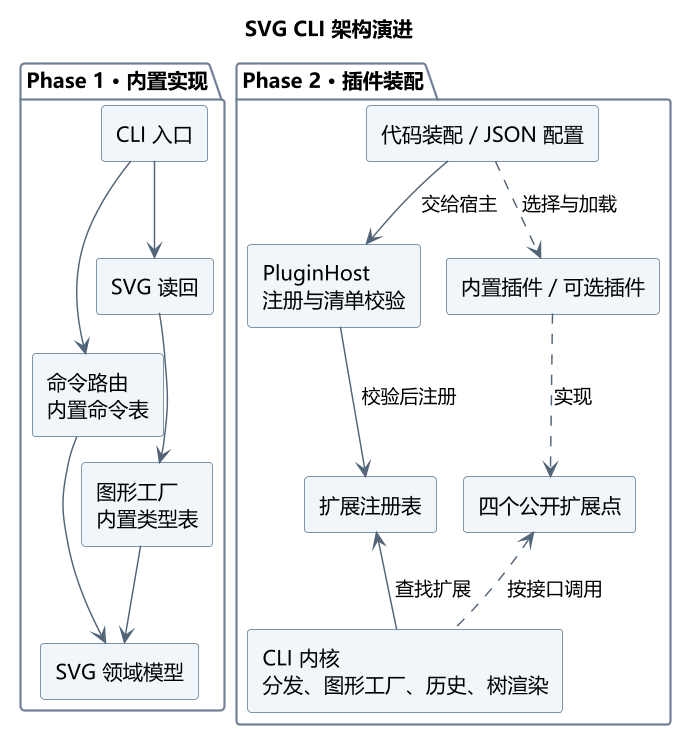

# Phase 2 迭代报告



对比图的 PlantUML 源文件是 `doc/architecture-comparison.puml`。

## 架构变化

Phase 1 用两张静态表分发命令和创建图形。Phase 2 将内置实现移到 `builtin`，由 `PluginHost` 验证并注册。命令路由、图形工厂、树渲染和属性处理通过注册表调用插件。代码入口列出要导入的插件，配置加载器从 JSON 读取同一组装配信息。

`stats` 遍历图形，`dir` 通过适配器读目录。`box` 由矩形和文本组成，填色和标题修改进入命令历史。`(box)` 和 `*` 各自读取图形视图，按注册顺序显示。

`doc/metrics/final.md` 显示，内核减少 677 行，圈复杂度下降 99。计入装配代码和插件后，CLI 增加 1065 行，圈复杂度增加 324。

## 装配差异复核

从 `8844109` 建两个工作树，再从 `401e9d6` 取出 `box` 插件和对应的装配改动。代码方式取 `src/index.ts`，配置方式取 `plugins.config.json`。

```sh
git worktree add --detach ../box-code-demo 8844109
git worktree add --detach ../box-config-demo 8844109
git -C ../box-code-demo restore --source 401e9d6 --staged --worktree -- src/index.ts src/plugins/box
git -C ../box-config-demo restore --source 401e9d6 --staged --worktree -- plugins.config.json src/plugins/box
git -C ../box-code-demo diff --cached --name-status
git -C ../box-config-demo diff --cached --name-status
git -C ../box-code-demo diff --cached --exit-code -- src ':(exclude)src/index.ts' ':(exclude)src/plugins/box'
git -C ../box-config-demo diff --cached --exit-code -- src ':(exclude)src/plugins/box'
```

分别构建两个版本，在相同初始目录回放 `doc/transcript/flowchart-box.txt`。两者的标准输出和 SVG 均与原 `box` 基线逐字节一致。当前默认装配还启用 `modified-star`，回放时使用双标签基线。

对比 `9e872c3` 和 `3964c4b`，新增插件目录以外的运行文件改动集中在 `src/index.ts` 和 `plugins.config.json`。`package.json` 增加了 `precli`，让 `npm run cli` 运行编译产物，避免宿主和插件加载两份 `Command` 基类。切换入口后移除了闲置的 `tsx` 依赖。

## 交付验收

| 范围 | 结果 |
| --- | --- |
| Phase 1 兼容性 | 禁用可选插件后，三个会话的输出和 SVG 与 `phase1-final` 逐字节一致。 |
| Phase 2 CLI | 36 项测试通过，包括目录适配器、双装配回放、加载失败、注册回滚、复合图形和标签状态。 |
| VS Code | 3 项解析测试和 Extension Development Host 测试通过。在 VS Code 1.103.2 中检查了徽标、源码定位、未保存编辑后的更新和不完整 XML 恢复。 |

从 Git 导出干净目录后，CLI 和扩展分别运行了 `npm ci` 和 `npm test`。使用 Node.js 26.13.1 和 npm 11.20.0。
